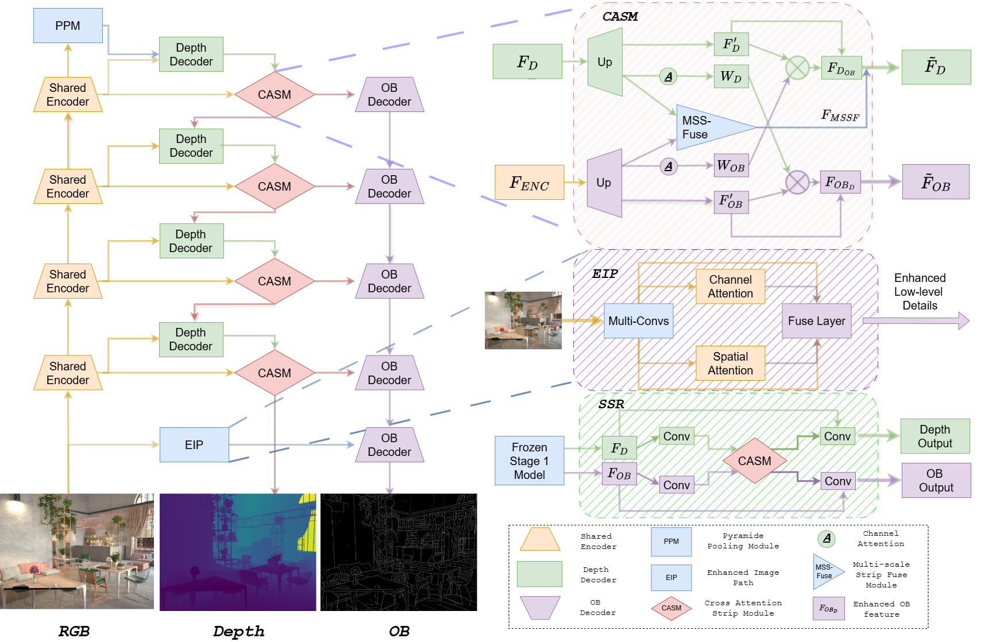

# MoDOT

Official implementation of the paper: **Occlusion Boundary and Depth: Mutual Enhancement via Multi-Task Learning (WACV 2026 Oral)** [link](https://openaccess.thecvf.com/content/WACV2026/html/Xu_Occlusion_Boundary_and_Depth_Mutual_Enhancement_via_Multi-Task_Learning_WACV_2026_paper.html).

In this work, we are the first to investigate the joint learning of occlusion boundary (OB) estimation and monocular depth estimation. As the two tasks provide complementary cues for understanding 3D scene geometry, our experiments demonstrate that incorporating OB supervision:

- improves depth estimation accuracy,
- yields sharper and more consistent boundaries,
- mitigates artifacts caused by high-frequency textures, and
- enhances the overall quality of 3D scene understanding.

## Table of Contents

- [Overview](#overview)
- [Dependencies](#dependencies)
- [Data Preparation](#data-preparation)
- [Configuration](#configuration)
- [Training & Inference](#training--inference)
- [Pre-trained Checkpoints](#pre-trained-checkpoints)
- [Extension to Human Face Parsing](#extension-to-human-face-parsing)
- [Acknowledgments](#acknowledgments)

------

## Overview

This repository provides the PyTorch implementation of our proposed **MoDOT** framework, along with all necessary resources:

- **`modot/`**: core MoDOT network architecture, losses, training & evaluation pipeline.
- **`configs/` & `scripts/`**: hyperparameters and `.sh` files for training and testing.
- **`data_splits/`**: train/test split files for main datasets used in the paper.

The general pipeline of MoDOT:

<p align="center">  </p>

------

## Dependencies

First, set up the Python environment using the provided `requirements.txt`.

```
# (Optional) create a virtual environment
# pip install wandb
pip install -r requirements.txt
```

------

## Data Preparation

For **OB-Hypersim**, we provide zipped sets containing images, depth maps, semantic segmentation, normals, instance contours, P2ORM OBs, and occlusion orientation maps (note: a few orientation files may be missing). We thank the authors of [P2ORM](https://github.com/tim885/P2ORM) and [Hypersim](https://github.com/apple/ml-hypersim) for their excellent work.

We also provide the **NYUD-MT** dataset and related files in the following repository. For other datasets used in the main paper and supplementary material, please refer to their official sources: [OB-FUTURE / OB-DIODE / OB-EntitySeg](https://github.com/xul-ops/IOBE), [DIODE (val)](https://diode-dataset.org/), [iBims-1](https://mediatum.ub.tum.de/1455541), and others cited in the paper.

Download link (OB-Hypersim & NYUD-MT):

- **BaiduNet:** https://pan.baidu.com/s/1gw_t4Mz2Y4jBEO36i9awPA
- **Extraction code:** `9doj`

------

## Configuration

- Update dataset paths and split files in **`configs/config.yml`**.
- Adjust parameters in **`parse_args.py`** and corresponding config text files in  **`configs/`** if needed.

------

## Training & Inference

Run the following scripts to train or evaluate MoDOT:

```
# MoDOT
sh scripts/train_eval.sh

# MoDOT with SSR
sh scripts/ssr_train_eval.sh

# Zero-shot evaluation
sh scripts/zero-shot_eval.sh
```

------

## Pre-trained Checkpoints

Download pre-trained MoDOT checkpoints from the link provided above.

------

## Extension to Human Face Parsing

Additional experiments conducted in March 2026 show that **MoDOT can be extended to human face parsing with minimal modifications**. We replace the depth head with a parsing head and the OB branch with SegFace's contour branch. We adapt OBDCL to encourage differences in class-probability vectors across semantic boundaries rather than depth discontinuities, while retaining CASM for explicit cross-task feature interaction. SSR is not used in this extension.

On **CelebAMask-HQ** at **512 × 512** resolution, MoDOT-L achieves **89.88 mean F1 / 82.76 mean IoU**, outperforming [SegFace (Swin-B)](https://github.com/kartik-3004/segface)'s **88.96 / 81.55** with substantially fewer training epochs. Neither method uses data augmentation on this dataset. Notably, MoDOT-L improves the F1 score for the long-tail **Necklace** class from **63.4 to 74.1**, while MoDOT-B improves **Earring** from **75.1 to 76.8**. MoDOT-B also surpasses SegFace overall (**89.81 / 82.64**) using the same Swin-B backbone. On **LaPa** at **512 × 512** resolution, MoDOT-B achieves **92.19 mean F1 / 86.87 mean IoU** without data augmentation, approaching SegFace's **93.03 / 88.14**, obtained with augmentation.

These results highlight MoDOT's **potential to generalize beyond joint OB and depth estimation to other boundary-aware dense prediction tasks**.

------

## Acknowledgments

We thank the following projects for providing code or inspiration: [NeWCRFs](https://github.com/aliyun/NeWCRFs), [MTORL](https://github.com/fengpanhe/MT-ORL), [Python Edge NMS](https://github.com/Walstruzz/edge_eval_python?tab=readme-ov-file) and other related works acknowledged in our paper.

------

Gmail: **xulintaofr@gmail.com**

If our project is helpful for your research, please consider citing:

```
@InProceedings{xu2026modot,
    author    = {Xu, Lintao and Wang, Yinghao and Wang, Chaohui},
    title     = {Occlusion Boundary and Depth: Mutual Enhancement via Multi-Task Learning},
    booktitle = {Proceedings of the IEEE/CVF Winter Conference on Applications of Computer Vision (WACV)},
    year      = {2026},
}
```

------

